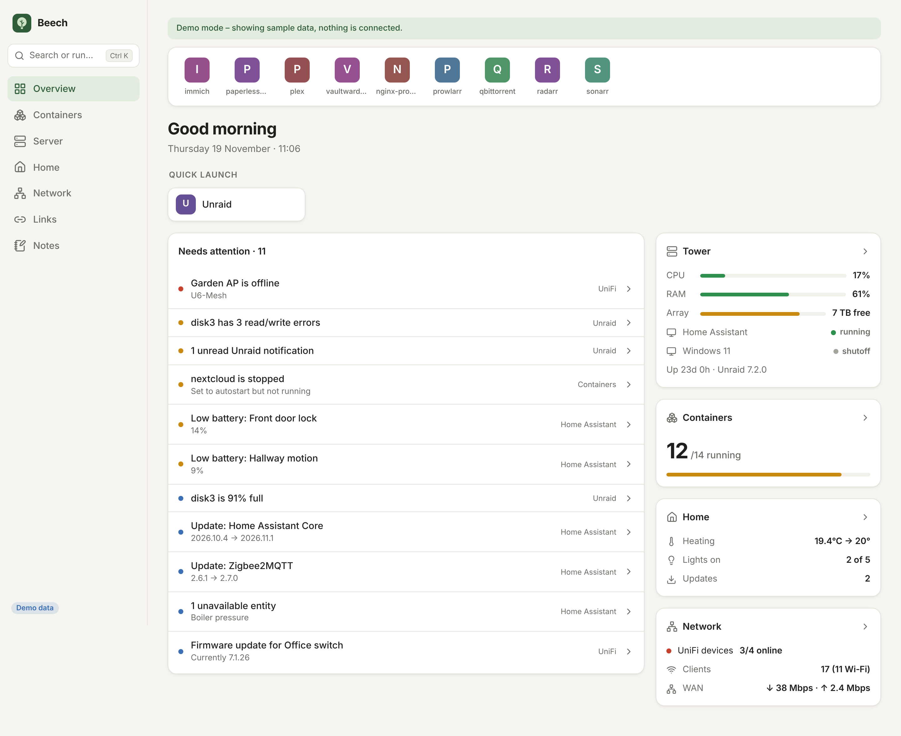

# BeechFront

Front page and admin console for everything at Beech – one place on the Mac or iPhone to see what needs attention and act on it across Unraid, Docker, Home Assistant and UniFi.



It's meant for running the house, so you can act on things from it as well as look at them:

| Page | What you can do |
| --- | --- |
| **Overview** | A **Needs attention** list pulled from every system: disks with errors or running hot, stopped autostart containers, the HA VM being down, low batteries, pending HA updates, offline UniFi devices, firmware updates, links that aren't responding. Plus quick launch and a summary card for each system. |
| **Containers** | Start, stop and restart containers, open their web UIs (worked out from Unraid's WebUI templates) and read or filter their logs. |
| **Server** | Unraid CPU, RAM, array capacity, per-disk usage, temperatures and errors, and unread notifications. Start, shut down, reboot or force-stop VMs (including Home Assistant). |
| **Home** | Home Assistant lights, switches, heating, locks, covers, scenes, scripts and automations, all controllable. You can also install updates, check the config, restart HA and search every entity. |
| **Network** | WAN throughput, UniFi devices (with CPU and memory, and a restart button) and every client, searchable by name, IP or MAC. |
| **Links** | Your bookmarks, grouped, each with a live up/down check and response time. Container web UIs are added automatically. |
| **Notes** | House notes, saved on the server: boiler service dates, where the stopcock is, to-dos. |

Press **⌘K** (or `/`) anywhere to search and run things, for example "restart plex", "kitchen" to toggle a light, or "open unifi". On the iPhone, open it in Safari and use **Share → Add to Home Screen** to install it as an app.

Anything that changes something (stopping a container, rebooting a VM, unlocking a door, restarting the gateway) asks you to confirm first.

## Install on Unraid

1. **Get the image.** Pushes to `main` build `ghcr.io/benjamin-leo-code/beechfront:latest` via GitHub Actions. If the repo is private, either make the package public under GitHub → Packages, or build it on Unraid with `docker build -t beechfront .`.
2. **Add the container.** Copy `templates/beechfront.xml` to `/boot/config/plugins/dockerMan/templates-user/my-beechfront.xml`. Then go to **Docker → Add Container** and choose *beechfront*. (`docker-compose.yml` is there as an alternative if you use the Compose Manager plugin.)
3. **Configure it.** Copy `config/config.example.yaml` to `/mnt/user/appdata/beechfront/config/config.yaml` and fill in your addresses. Put the secrets in the container's variables, not in the file.
4. Open `http://<unraid-ip>:8484`.

### Keys you'll need

| System | Where to create it | Variable |
| --- | --- | --- |
| Console login | Choose a password | `BEECHFRONT_PASSWORD` |
| Unraid (7.x) | Settings → Management Access → API Keys | `UNRAID_API_KEY` |
| Home Assistant | Profile → Security → Long-lived access tokens | `HA_TOKEN` |
| UniFi Network (9+) | UniFi Network → Settings → Control Plane → Integrations | `UNIFI_API_KEY` |
| Docker | Mount `/var/run/docker.sock` (the template already does this) | – |

You can leave any of them out. That system's page just won't appear.

### Security

The console can stop containers, reboot VMs and unlock doors, and having the Docker socket mounted gives it root-equivalent access to the server. Keep these rules:

- **Always set `BEECHFRONT_PASSWORD`.** Sessions last 30 days, so the iPhone won't keep asking you to sign in.
- **Don't port-forward it to the internet.** Use it on the LAN, or from outside over Tailscale or the UniFi VPN.
- API keys stay on the server. The browser only ever talks to BeechFront.

## Development

```sh
npm install
npm run dev:demo     # sample data, no real systems needed → http://localhost:5173
npm run dev          # uses config/config.yaml
npm run build && npm start
```

Demo mode (`BEECHFRONT_DEMO=1`) swaps every integration for in-memory sample data. Actions still work against that data, which makes it handy for working on the UI.

### Layout

```
server/                 Fastify API (Node 22, no build step)
  index.js              routes, caching, static hosting
  overview.js           builds the "Needs attention" list
  integrations/         docker · unraid (GraphQL) · homeassistant · unifi · links · notes
  demo.js               sample data
web/src/                React + TypeScript front end (Vite)
  pages/                one file per page
  CommandPalette.tsx    ⌘K
config/config.example.yaml
```

To add a new system, write `server/integrations/<name>.js`, give it routes in `server/index.js`, optionally add attention rules in `overview.js`, and add a page under `web/src/pages/`.

### Notes on the APIs

- **Unraid:** the GraphQL schema has changed between 7.x releases. Each section (system, array, VMs) is queried separately, with fallbacks, so a missing field only blanks that one card.
- **UniFi:** uses the official Integration API. For a self-hosted Network Application, rather than a UniFi console or gateway, set `unifi.url` to it and adjust `apiBase` if necessary.
- Self-signed certificates are accepted for Unraid, Home Assistant and UniFi by default. Set `insecure: false` on any of them to enforce validation.
